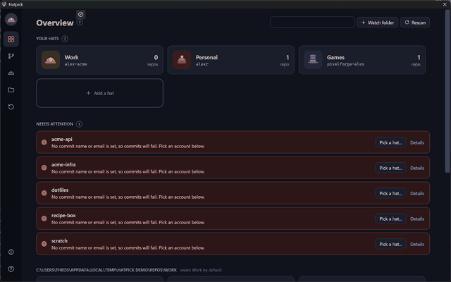
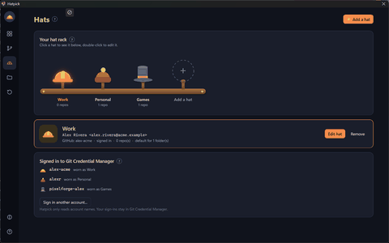
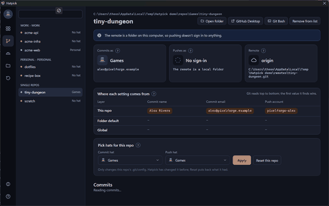
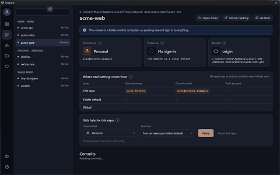
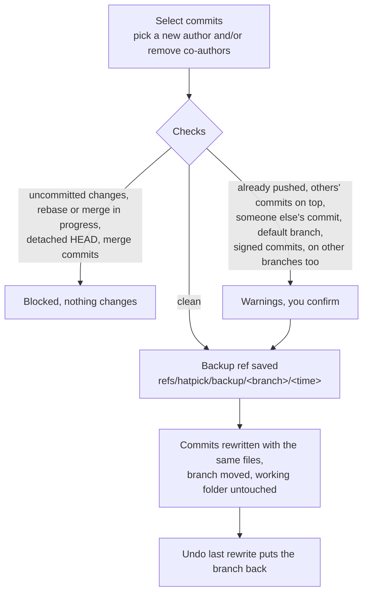
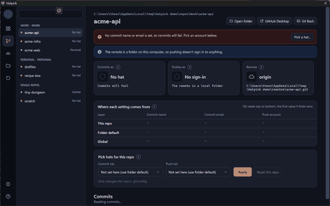

<p align="center">
  
</p>

<p align="center">
  <a href="https://github.com/Theo-Erickson/Hatpick/releases"></a>
  
  
  
</p>

<p align="center">
  <a href="#what-it-does">What it does</a> ·
  <a href="#getting-started">Getting started</a> ·
  <a href="#how-it-decides">How it decides</a> ·
  <a href="#fixing-commits">Fixing commits</a> ·
  <a href="#building">Building</a> ·
  <a href="#history">History</a>
</p>

Each of your GitHub accounts is a **hat**. Hatpick makes sure every repo wears the right
one, both for the name on your commits and for the account you push with. It shows why a
repo wears what it wears, and it can fix the author of commits before (or after) you push.
The name is a nod to a hat trick.

<p align="center">
  
</p>

> [!NOTE]
> Hatpick never asks for a password or token and never sees one. Your GitHub sign-ins stay
> in **Git Credential Manager** (GCM), which ships with Git for Windows and installs separately
> on macOS and Linux. Hatpick only writes
> plain git settings that say *which* sign-in to use.

## What's new in 3.2

| | |
|---|---|
| **macOS and Linux** | Hatpick now runs on Windows, macOS and Linux. Each download is still one file with nothing to install. |

## What's new in 3.1

| | |
|---|---|
| **Hat rack** | The Hats page is a rack with a peg for every hat. Click a hat to see it, double-click to edit it. It grows as you add hats. |
| **Your colors, or your picture** | Recolor each part of a hat (a top hat's body, band and top, for example), or upload a picture to use instead. |
| **The badge follows the repo** | On the Repos page, the hat in the top-left corner is the one the repo you're looking at wears. |
| **Demo mode** | `Hatpick.exe --demo` runs on made-up accounts and sample repos, so you can try it (or record it) without touching your real setup. |

## What it does

```
user.name / user.email                       who commits are authored by
credential.https://github.com.username       which GCM sign-in is used to push
```

Hatpick reads and writes those settings, nothing else. It reads the list of signed-in
account *names* (`git credential-manager github list`) and never runs `git credential fill`,
the command that would return a token.

A slim rail on the left switches pages; theme and help sit at the bottom.

- **Overview**: your hats, a *Needs attention* list with one-click fixes, and every repo
  as a card showing the hat it commits with and the hat it pushes with. Two different hats
  means they don't match; a dashed circle means no hat.
- **Repos**: one repo in detail. You see who it commits and pushes as, a *Where each
  setting comes from* table (the winning value is highlighted), hat pickers and its recent
  commits.
- **Hats**: your hat rack. You can add, edit and remove hats (label, commit name and email,
  GitHub username, hat, colors or picture) and see which accounts are signed in to GCM.
- **Folders**: watched folders and their default hats, single repos and the optional
  Explorer right-click entry (Windows).
- **Reset**: undo everything Hatpick changed.

<table>
  <tr>
    <td align="center" width="50%"><br><sub>The hat rack</sub></td>
    <td align="center" width="50%"><br><sub>A hat in your own colors</sub></td>
  </tr>
</table>

Every section has a **?** button that explains it. On first launch, a short setup walks you
through signing in accounts, making hats and adding folders. **Help** can rerun the setup or
take the one-minute tour. Dark and light themes are built in.

## Getting started

1. Install git and Git Credential Manager:
   - **Windows:** [Git for Windows](https://git-scm.com/download/win) includes both.
   - **macOS:** `brew install git` and `brew install --cask git-credential-manager` (or the
     installers from [git-scm.com](https://git-scm.com/download/mac) and
     [GCM](https://github.com/git-ecosystem/git-credential-manager/releases)).
   - **Linux:** git from your package manager, and GCM from its
     [releases page](https://github.com/git-ecosystem/git-credential-manager/releases).
2. Download Hatpick for your system from the [latest release](https://github.com/Theo-Erickson/Hatpick/releases/latest),
   or build it yourself (see [Building](#building)), and run it. Nothing else to install.

   | | Download | Run |
   |---|---|---|
   | Windows | `Hatpick.exe` | Double-click it. |
   | macOS | `Hatpick-macos-arm64.zip` (Apple silicon) or `-x64` (Intel) | Unzip, then right-click *Hatpick* > *Open* the first time (it isn't notarized). |
   | Linux | `Hatpick-linux-x64.tar.gz` or `-arm64` | Extract and run `./Hatpick`. |
3. Follow the setup: sign in each GitHub account once through GCM, make a hat for each, and
   point Hatpick at the folders that hold your repos.

> [!TIP]
> Want to look around first? `Hatpick --demo` (`Hatpick.exe --demo` on Windows) opens with
> three made-up hats and a handful of sample repos in a `Hatpick demo` folder in your temp
> folder. Your real config, sign-ins and registry are left alone, and the demo is rebuilt fresh
> each time.

## How it decides

**Watched folders** hold your repos, like `Documents/GitHub`. Every repo inside is listed
(up to 4 levels deep, skipping build folders such as `Intermediate`, `Saved` and
`node_modules`). A folder's **default hat** applies to every repo in it, including repos you
clone or create there later. **Single repos** live somewhere else, and you pick their hat
directly. **Analyzing** any folder (drop it on the window, use *Folders > Analyze a folder*,
the command line, or the Explorer entry on Windows) shows it without adding it.

A repo's own setting beats its folder default, which beats your global settings:


<p align="center">
  
</p>

## Fixing commits

On a repo's page, the **Commits** section lists recent commits on the current branch with
their author's hat, any `Co-authored-by` lines, and whether each is **Local** or **Pushed**.
If commits you haven't pushed yet were made with a different hat than the repo wears,
Hatpick offers to fix them before you push.



> [!WARNING]
> Hatpick never pushes. For commits that were already pushed, use *Force push* in GitHub
> Desktop (or `git push --force-with-lease`), and anyone who pulled them will need to reset.

<p align="center">
  
</p>

### Undoing commits

**Undo commits, keep the changes** takes the selected commits (and anything newer) off the
branch while leaving their changes in your folder, ready to commit again. Use it to drop a file
from a commit, fix a message or split commits up. It's `git reset --soft` with a backup first,
and *Undo last change* puts the commits back.

## Resetting

The first time Hatpick changes a repo's settings, it saves what the repo had in a `[hatpick]`
section of that repo's `.git/config`. *Reset this repo* puts that back exactly. The **Reset**
page does it for every repo at once and can remove all folder defaults. Commits, branches and
GCM sign-ins are never touched.

<details>
<summary><b>GitHub Desktop users</b></summary>

GitHub Desktop uses each repo's commit name and email. When it **pushes** to github.com it
uses the account you're signed into in Desktop, not GCM. For a repo that belongs to your
other account, push from a terminal (`git push` goes through GCM), or add Desktop's account as
a collaborator.

</details>

<details>
<summary><b>If something goes wrong</b></summary>

Unexpected errors are written to `hatpick-error.log`, and the message says where. Hatpick
keeps that log, its settings (`hatpick.json`) and custom hat pictures (a `hats` folder) in:

| | |
|---|---|
| Windows | next to `Hatpick.exe` |
| macOS | `~/Library/Application Support/Hatpick` |
| Linux | `~/.config/hatpick` (or `$XDG_CONFIG_HOME/hatpick`) |

</details>

## Building

Hatpick is C# on .NET 10 with [Avalonia](https://avaloniaui.net) for the window, so one
codebase runs everywhere. Install the [.NET 10 SDK](https://dot.net), then:

| On | Run | You get |
|---|---|---|
| Windows | `build.cmd` | `Hatpick.exe` in the repo folder (close Hatpick first) |
| macOS | `./build.sh` | `dist/osx-arm64/Hatpick.app` (or `osx-x64`) |
| Linux | `./build.sh` | `dist/linux-x64/Hatpick` (or `linux-arm64`) |

Each is a single self-contained file of about 50 MB. Pass a target to build for another
machine, for example `./build.sh linux-arm64`. GitHub Actions builds all of them on every push,
and attaches them to a release when you push a `v*` tag.

| Where | What |
|---|---|
| `src/Styles.axaml` | Control looks (Avalonia control themes) |
| `src/Platform.cs` | Everything that differs between Windows, macOS and Linux |
| `src/Theme.cs` | Color palettes. Adding a theme is one more palette. |
| `src/Ui.cs` | Shared building blocks, including the drawn hats and their colorable parts |
| `src/Demo.cs` | `--demo` mode and its sample data |
| `tools/make-icon.py` | Draws `hatpick.ico` (Python with Pillow 10.1+) |
| `tools/readme_capture/` | Records demo mode as PNG frames on Windows (the GIFs in this README were made from them) |

The icon shows the hat trick (hard hat, top hat, beanie) at 64px and up. At 48px and below,
which covers the Start menu and taskbar, it shows just the hard hat and the beanie. The macOS
build turns `hatpick.ico` into the app's icon.

```powershell
python tools\make-icon.py hatpick.ico hatpick.png
```

## History

| Tag | Version |
|---|---|
| `v1.0-gitpicker` | First version, named GitPicker |
| `v1.1-hatpick` | Renamed to Hatpick |
| `v1.2-hat-trick-icon` | Hat-trick icon |
| `v2.0-analyzer` | Repo analyzer, reset, first-run setup, tour and help |
| `v3.0-wpf` | New WPF interface with themes, hats everywhere, and commit author fixing |
| `v3.1-hat-rack` | Hat rack, hat colors and pictures, repo badge, demo mode |
| `v3.2` | Runs on Windows, macOS and Linux (Avalonia) |

To get any version as its own folder:

```powershell
git worktree add ..\Hatpick-v1.0 v1.0-gitpicker
```

